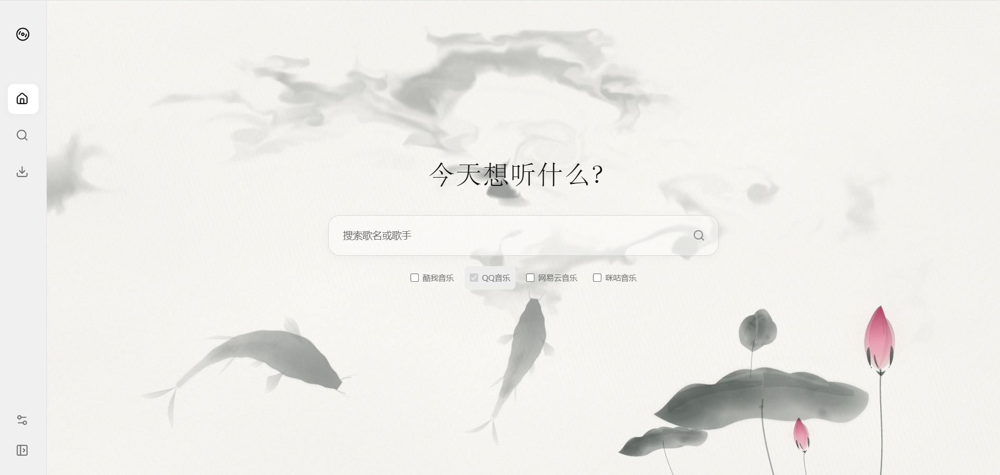

# 拾音 · Music Core

Music Core 是一个在本机运行的音乐客户端。你可以在同一个界面搜索酷我、QQ 音乐、网易云音乐和咪咕，在线播放、看同步歌词，也可以选择音质下载。启用本机模式后，还可以管理和播放电脑上的音乐文件。

- **听歌**。加入播放队列，边听边看同步歌词。
- **下载**。选择音质并保留原格式。在支持转码的环境中，也可以把 FLAC 保存为 MP3。
- **换首页背景**。在设置里切换「墨息」和「字里弦间」。

可播放和下载的歌曲、音质因来源而异。



## 启动

以下是 Windows Git Bash 的步骤。macOS / Linux 的安装与启动差异见[开发环境与验证](docs/development/setup.md)。

### 首次安装

准备 Python 3.10、Node.js 22.x（建议 22.12 或更新）和 pnpm。下面的命令从项目根目录执行，只安装依赖，不启动服务。

```bash
cd server
python -m venv .venv
./.venv/Scripts/python.exe -m pip install -r requirements-dev.lock.txt
cd ../web
pnpm install --frozen-lockfile
```

### Windows 双击打开

安装依赖后，在 Windows 文件资源管理器里双击项目根目录的 **打开音乐客户端.vbs**。它会启动服务并打开页面。从这个入口可以在设置里管理本机音乐库，不用再执行下面的手动启动命令。退出时双击 **关闭音乐客户端.vbs**，只关闭经身份核验由本启动器启动的服务，手动启动及此前未登记的服务会保留。

如果已有手动启动的网页模式后端，双击入口不会自动把它切成本机模式。想用本机音乐库时，先结束自己启动的网页模式服务，再双击打开。

### 手动启动或开发调试

从项目根目录打开两个终端。终端一启动后端：

```bash
cd server
./.venv/Scripts/python.exe -m uvicorn app.main:app --reload --host 127.0.0.1 --port 8001
```

终端二启动前端：

```bash
cd web
pnpm dev
```

两个终端保持运行，然后打开 [http://127.0.0.1:5174](http://127.0.0.1:5174)。未额外配置时，这种启动方式使用网页模式。

## 下载存在哪

- **网页模式**。下载由浏览器保存到打开页面的电脑或手机，保存位置由浏览器决定。项目不会把这些文件加入本机音乐库。
- **本机模式**。文件保存到设置中指定的音乐库。更改目录默认只影响新下载，勾选迁移才会搬动符合条件的旧下载。

## 开发者入口

`web/`：网页版和桌面版共用的 Vue 3 + TypeScript 界面。
`desktop/`：Tauri 2 Windows 桌面外壳及 Rust 搜索、会话与媒体传输。
`server/`：网页版及原有本机启动器使用的 Python/FastAPI 后端。

桌面开发、构建和验收记录见[桌面开发说明](docs/development/desktop.md)。

- [开发环境与验证](docs/development/setup.md)
- [系统架构概览](docs/architecture/overview.md)
- [后端专用说明](server/README.md)

## 使用范围

当前配置只适合本机使用，不具备面向公网部署所需的认证和访问控制。
请在符合来源服务条款及适用版权要求的前提下使用播放和下载功能。

## 许可证

拾音的原创代码采用 [MIT License](./LICENSE)。
第三方组件、字体及素材遵循各自的许可。音乐、歌词和封面不在本项目的 MIT 授权范围内。
