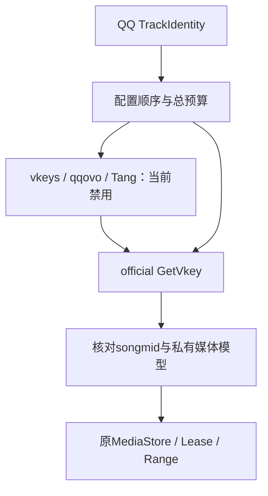

# 09 QQ解析审核 — QQ解析路线复核

本记录汇总旧实现中的QQ取链路线和研究来源中的协议对照；具体历史路径与会话材料不作为当前运行依据。

| 路线 | 实际请求及输入 | 输出与依赖 | 本期判断 |
|---|---|---|---|
| vkeys |
| qqovo | qqovo.top/api/session/bootstrap，再/api/meting，server=tencent/type=url/id=mid/quality=lossless | 独立会话、deviceId、bootstrap与HMAC-SHA256请求签名 | 未采用；不复用历史会话或服务密钥，使用条件未确认 |
| Tang | tang.api.s01s.cn/music_open_api.php，mid | 返回MID及歌曲元数据；需排除伴奏和录音错配 | 未采用；需具备录音核验依据和明确使用条件 |
| GetVkey | QQ自身music.vkey.GetVkey.UrlGetVkey，songmid数组、普通客户端参数 | midurlinfo.songmid与purl/sip；可选自有QQ Cookie仅留官方API | 已实现并验证，默认唯一可执行路线 |

研究来源记录的外部路线包含多组候选，默认会按内部优先级尝试；非空账号会改变分支，搜索流程也可能先尝试外部解析。此处只保留与当前评估有关的行为概述。

旧实现曾按固定顺序调用外部路线，再回退到QQ自身接口。外部结果可能只有URL或请求绑定信息，时长接近不能证明录音身份；当前策略要求身份依据和服务使用条件充分后才能接入。

早期有限样本曾记录取链与播放结果；后续样本和程序条件并不完全相同，不能互相替代。这些结果只作为历史实验记录，不代表当前可用性；当前请求不复用历史地址、文件或凭据。

本次未确认外部服务条款、运营授权或身份响应，因此未向其发送歌曲取链请求，也不据主页访问失败判断服务已失效。对使用条件未知的受限曲目不做取链实验；历史样本不等同于内容授权或录音身份确认。

QQProvider构造参数route_order默认official、resolve_timeout默认25秒（正数且最多60）、continue_on_transient默认True。服务端环境变量MUSIC_CORE_QQ_RESOLVER_ORDER为逗号分隔顺序，默认official；不提供HTTP修改入口。空、重复、未知配置拒绝，已知但禁用的外部路线跳过，全部禁用返回明确415类别。available_routes当前仅official，不提供环境变量解禁外部服务。

总预算覆盖整次取链，内部既有20秒请求上限保留；取消立即向下传递。成功后停止；仅upstream_timeout、upstream_failure、media_unavailable在策略允许时继续；权限拒绝、身份/结构异常立即停止，不伪造权限原因。空purl仍是media_unavailable。测试用人工路线验证顺序和回退，不代表外部适配器已接入。

官方songmid回显与签名媒体上下文作为当前来源依据；有限媒体探测独立记录。公开DTO不加入resolverId或URL，没有新增第三方媒体域、共享Cookie、TLS放宽或全局插件系统。未来真正接入外部路线仍需独立验证身份、使用条件、可信主机、每跳重定向与有界音频字节，不能只返回URL便进入Store。
