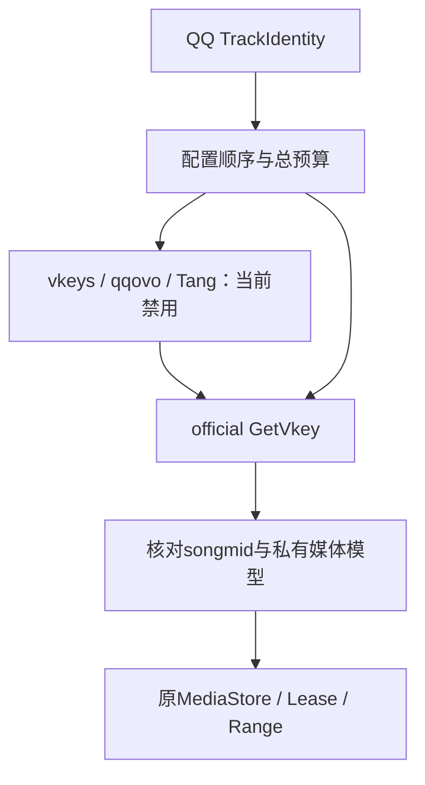

# QQ解析路线复核

只读依据：旧项目server/app/qq_fallback.py、qq_routes.py、provider_adapter.py，notes/39-qq-resolver-target-review/README.md及周杰伦回归更正.md、notes/00-交接文档存点/2026-10-12-QQ三路对照完成存点.md；冻结musicdl/modules/sources/qq.py。

| 路线 | 实际请求及输入 | 输出与依赖 | 本期判断 |
|---|---|---|---|
| vkeys | api.vkeys.cn/music/tencent/song/link，mid与quality | data.url；原库品质循环、歌词补充、AudioLinkTester；通常缺少MID回显 | 未迁入；没有当前服务使用条件或充分录音证据 |
| qqovo | qqovo.top/api/session/bootstrap，再/api/meting，server=tencent/type=url/id=mid/quality=lossless | 独立Session、deviceId、bootstrap给apiSignKey；时间戳/nonce/排序query以HMAC-SHA256生成X-OM签名，返回url | 未迁入；不复用历史会话或服务密钥，当前准入未确认 |
| Tang | tang.api.s01s.cn/music_open_api.php，mid | song_mid、名称/歌手/专辑/时长及多个song_play_url字段；原函数可能选到accom伴奏 | 未迁入；需要同MID、版本核验及服务使用条件 |
| GetVkey | QQ自身music.vkey.GetVkey.UrlGetVkey，songmid数组、普通客户端参数 | midurlinfo.songmid与purl/sip；可选自有QQ Cookie仅留官方API | 已实现并验证，默认唯一可执行路线 |

冻结默认并非三路：L1列表切片实际先vkeys、xcvts，随后L2 chksz、qqovo、nki、Tang、hk0cc，再其他组。非空账号Cookie跳过第三方。搜索中先逐首第三方，再官方；有效无损结果可能替代官方，不保证每首都会请求所有方法。

旧Lab精简为vkeys→qqovo→Tang→官方，clone原函数注入受限Transport而非复制整个库。Transport限制TLS、时间与次数。早期要求回显MID，后期resolve_priority使用require_response_mid=False允许vkeys/qqovo仅请求绑定，并以实测时长接近搜索interval作筛查。Tang检查所选字段，拒绝伴奏和MID错配。SongInfo.identifier由请求MID赋值，不能把它当响应独立身份证据；时长近似也不能排除同长度翻唱或不同版本。

历史存点记录晴天0039MnYb0qxYhV、普通朋友004FITZG2U6rAF、明月天涯0012mUEO3j7Xwj曾有CLI三路取链/完整文件检查，以及Tang浏览器播放。后续报告记录七里香004Z8Ihr0JIu5s和晴天曾被实验准入门槛阻断，修复后只重新实测红尘客栈。不同日期、程序和样本不能互相替代；这些是历史成功，不是本次当前成功。未复用历史签名地址、文件或凭据。

本次访问三个外部根站的公开页面均未取得可读结果；未确认服务条款、运营授权或身份响应，不向它们发歌曲取链请求，不据此宣称服务已失效。任务明确要求不在使用条件未知时对受限曲目实验，因此晴天/普通朋友/七里香仅保留历史角色，不把付费标记、用户任务授权或URL可访问等同于平台内容授权。

QQProvider构造参数route_order默认official、resolve_timeout默认25秒（正数且最多60）、continue_on_transient默认True。服务端环境变量MUSIC_CORE_QQ_RESOLVER_ORDER为逗号分隔顺序，默认official；不提供HTTP修改入口。空、重复、未知配置拒绝，已知但禁用的外部路线跳过，全部禁用返回明确415类别。available_routes当前仅official，不提供环境变量解禁外部服务。

总预算覆盖整次取链，内部既有20秒请求上限保留；取消立即向下传递。成功后停止；仅upstream_timeout、upstream_failure、media_unavailable在策略允许时继续；权限拒绝、身份/结构异常立即停止，不伪造权限原因。空purl仍是media_unavailable。测试用人工路线验证顺序和回退，不代表外部适配器已接入。

官方songmid回显与签名媒体上下文作为当前来源依据；有限媒体探测独立记录。公开DTO不加入resolverId或URL，没有新增第三方媒体域、共享Cookie、TLS放宽或全局插件系统。未来真正接入外部路线仍需独立验证身份、使用条件、可信主机、每跳重定向与有界音频字节，不能只返回URL便进入Store。
